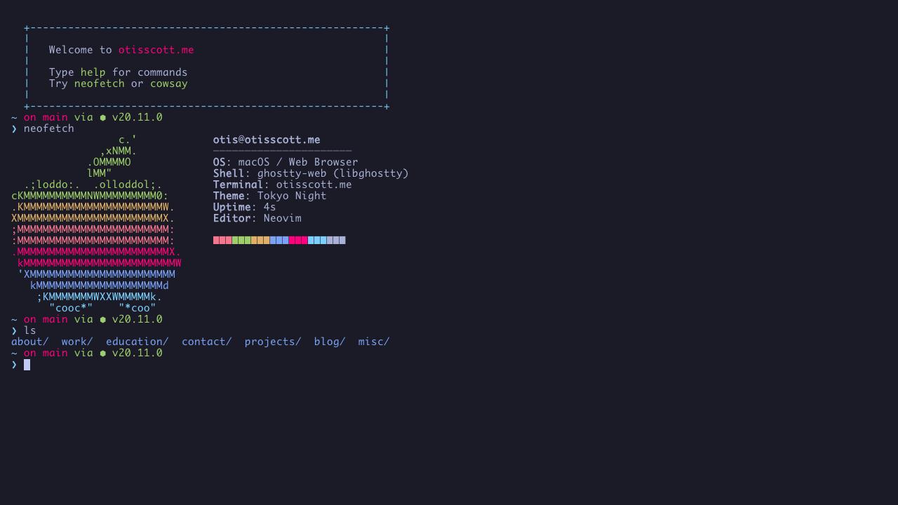

# otisscott.me

A terminal-emulated personal website built with Next.js, TypeScript, and libghostty. Features a fully functional terminal interface with 40+ commands, multiple themes, and easter eggs.



## Features

- **Real Terminal Emulation** — Ghostty's own VT parser, compiled to WASM
- **40+ Commands** — navigation, portfolio, dev tools, easter eggs
- **Multiple Themes** — Tokyo Night, Dracula, Nord, and more (light/dark auto-detection)
- **Pure Prompt** — git-aware prompt with branch and Node version
- **Tab Completion** — commands and file paths with ghost text suggestions
- **Command History** — arrow key navigation with `history | grep` support, saved across visits
- **Command Links** — `otisscott.me/#experience` or `/#fortune|cowsay` runs that command on load; only argument-free commands from the `LINKABLE` list in `Terminal.tsx`, so a link cannot put its own text on the page
- **curl-friendly** — `curl -L otisscott.me` returns a colored text profile (`proxy.ts` rewrites CLI user agents to `app/cli/route.ts`)
- **Wine Pairing** — `pair <food | grape>` with an everyday and a splurge bottle (`lib/filesystem/pairings.ts`)
- **Sharing** — `share` copies a link that reruns your last linkable command
- **Mobile Key Bar** — Tab, Esc, arrows and ^C on touch screens
- **Line Editing** — Ctrl+A/E/K/U/W/L/D, Home/End, Delete; long lines wrap and edit correctly
- **Persistent State** — todo list, aliases and history saved to localStorage
- **Responsive** — auto-fits viewport, handles resize

## Tech Stack

- **Framework**: Next.js 16 (App Router, Turbopack)
- **Language**: TypeScript
- **Terminal**: [ghostty-web](https://github.com/coder/ghostty-web) — libghostty compiled to WASM, with FitAddon and OSC 8 / URL link providers
- **Styling**: Global CSS
- **Deployment**: Vercel

## Getting Started

```bash
bun install
bun dev
# Open http://localhost:3000
```

Adding a command means one entry in `components/commands/dispatch.ts` — help text,
tab completion, and execution all derive from it.

The page also server-renders a plain HTML profile (name, role, experience, contact)
from the same virtual filesystem data, via `lib/filesystem/profile.ts`. Crawlers,
link previews and screen readers read it; it is shown visibly when JavaScript is off or
the terminal fails to load.

`bun scripts/take-screenshot.mjs` (with `bun dev` running) regenerates the README
hero and the Open Graph image `app/opengraph-image.png`.

`gl` output is generated from real git history by `scripts/update-git-log.sh`, which
runs as part of `bun run build` (or on demand via `bun run sync:gitlog`).

## Commands

### Navigation
| Command | Description |
|---------|-------------|
| `ls [-la]` | List directory contents |
| `cd [path]` | Change directory |
| `cat [file]` | Display file contents (renders markdown/JSON) |
| `pwd` | Print working directory |
| `tree [path]` | Directory tree view |
| `grep <pattern>` | Search file contents |
| `open <file\|url>` | Open URL in new tab |

### Portfolio
| Command | Description |
|---------|-------------|
| `whoami` | User identity |
| `skills` | Technical skills by category |
| `experience` | Work history |
| `projects` | Portfolio projects |
| `contact` | Email and social links |
| `pair <food\|grape>` | Wine pairing with everyday and splurge bottles |

### Tools
| Command | Description |
|---------|-------------|
| `help` | All available commands |
| `man <cmd>` | Manual pages for any command |
| `history` | Command history (`history \| grep` supported) |
| `todo` | Persistent todo list (add/done/rm/clear) |
| `alias` | Define command aliases (persistent) |
| `cal` | Calendar with today highlighted |
| `theme [name]` | Switch color theme |
| `neofetch` | System info display |
| `ping [host]` | Simulated ICMP |
| `date` | Current date/time |
| `share [cmd]` | Copy an otisscott.me link that runs a command |

### Easter Eggs
| Command | Description |
|---------|-------------|
| `docker` | Container management (ps, images, compose) |
| `ssh` | Connection animation |
| `htop` | Live process viewer with project-themed processes |
| `scp` | File transfer animation |
| `make` | Build animation |
| `jobs` / `fg` / `bg` | Background job system (append `&` to any command) |
| `uptime` | Session uptime |
| `vim` | Good luck getting out |
| `cowsay` | ASCII cow |
| `sl` | Steam locomotive |
| `rm -rf /` | Don't worry about it |
| `claude` / `codex` / `opencode` | AI tool easter eggs |

## Project Structure

```
proxy.ts                   # Sends curl/wget/HTTPie/xh to the text profile

app/
├── cli/route.ts           # Plain-text ANSI profile for CLI clients
├── globals.css            # Global styles
├── layout.tsx             # Root layout + metadata
├── opengraph-image.png    # Link-preview image
├── page.tsx               # Profile + terminal
├── Profile.tsx            # Server-rendered HTML profile
└── TerminalLoader.tsx     # Client-only terminal import

components/
├── terminal/
│   └── Terminal.tsx        # terminal setup, key handling, shell (pipes, jobs, aliases)
└── commands/
    ├── dispatch.ts         # Command table — help, completion, and execution
    ├── handlers.ts         # Command implementations
    ├── interactive.ts      # Animations + full-screen modes
    └── man-pages.ts        # Man page content

lib/
├── cli-screen.ts          # Builds the curl output
├── filesystem/
│   ├── data.ts            # Virtual filesystem content
│   ├── pairings.ts        # Wine pairing styles, bottles and food keywords
│   ├── profile.ts         # Name, role, experience, contact (shared by terminal + HTML)
│   └── types.ts           # Types + ANSI codes
└── theme/
    ├── themes.ts          # Theme registry
    └── tokyo-night.ts     # Base theme
```

## License

MIT
